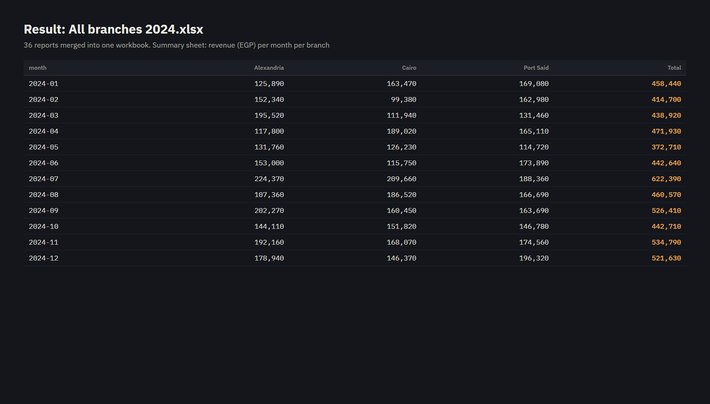

# Excel Merger and File Organizer

A Python script for a job people do by hand every month: tidy a messy folder, and merge dozens of monthly Excel
reports into one workbook.


## What it does

- Recognises each monthly branch report **whatever it's called** (`sales_cairo_jan_2024.xlsx`,
  `Cairo Jan 2024 report.xlsx`, `jan-cairo-sales-final.xlsx`, `Sales Jan24 (Cairo).xlsx` …), then renames it to one
  pattern (`2024-01 Cairo.xlsx`) and files it under `Reports/<branch>/`
- Moves invoices (PDF) to `Invoices/`, photos to `Images/`, everything else to `Other/`
- Merges all the reports into **`All branches 2024.xlsx`**, with all sales in one sheet, a **Summary** sheet (revenue
  per month per branch) and a **Totals** sheet
- Writes `organize_log.csv`, one line per file showing where it went, so nothing disappears silently
- `--dry-run` shows what it would do without moving anything

On the demo folder it sorted 55 files and merged 36 reports (738 sales rows).



## Run it

```bash
pip install -r requirements.txt
python make_demo_inbox.py                  # creates demo_inbox/ with 55 messy files
python organize_and_merge.py demo_inbox --dry-run
python organize_and_merge.py demo_inbox
```

## Built with

Python · pandas · openpyxl
